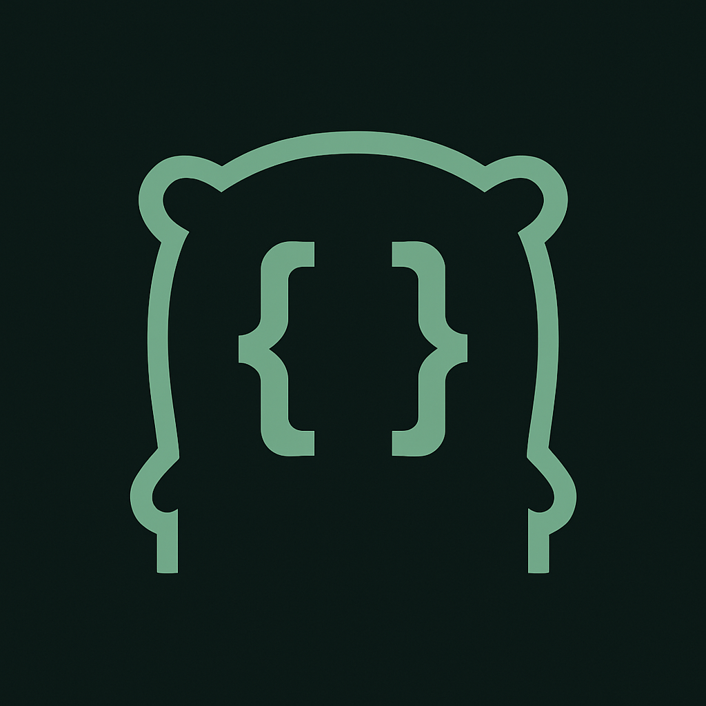

# GoTyper

[](https://github.com/mcncl/gotyper/actions/workflows/ci.yml)
[](https://codecov.io/gh/mcncl/gotyper)
[](https://golang.org/)
[](LICENSE)
[](https://github.com/mcncl/gotyper/releases)

<p align="center">
    
</p>

Generate Go structs from JSON samples or JSON Schema. GoTyper reads files,
stdin, or URLs and writes formatted Go code with JSON tags. Configuration adds
YAML/XML tags, field naming, type mappings, and validation tags.

## Install

With Go 1.27 or later:

```bash
go install github.com/mcncl/gotyper@latest
```

Or download a binary from [GitHub releases](https://github.com/mcncl/gotyper/releases).

## Quick start

```bash
echo '{"id": 1, "name": "Ada"}' | gotyper -r User -p models
```

Output:

```go
// Code generated by gotyper. DO NOT EDIT.

package models

type User struct {
	Id   int64  `json:"id"`
	Name string `json:"name"`
}
```

## Usage

```bash
# Read a file and write Go code
gotyper -i user.json -o user_generated.go -p models -r User

# Fetch JSON from an API
gotyper --url https://api.github.com/users/octocat -r GitHubUser

# Merge multiple samples into one model
gotyper --sample first.json --sample second.json -r Response -o response.go

# Read newline-delimited JSON
gotyper --ndjson -i responses.ndjson -r Response

# Generate from JSON Schema instead of samples
gotyper --schema user.schema.json -p models -r User
```

Run `gotyper` without arguments to paste JSON interactively. Finish with Ctrl+D
on Unix/macOS, or Ctrl+Z followed by Enter on Windows. Run `gotyper --help` for
all flags and defaults.

Each ordinary input contains one JSON value. Use repeated `--sample` flags for
multiple files, or `--ndjson` for one value per nonblank line. `--sample` cannot
be combined with `--input`, `--url`, `--schema`, or `--interactive`; `--ndjson`
cannot be combined with `--schema`.

### How types are inferred

- Object samples merge their fields, including objects inside arrays.
- Integers use `int64`; decimal/exponent numbers and integers outside that range
  use `float64`. Mixed numeric samples use `float64`.
- Missing or null fields use pointers by default. Incompatible types fall back
  to `interface{}`.
- Valid RFC3339 timestamps use `time.Time`. Other date strings and UUIDs stay
  strings.

See the [reference](docs/reference.md) for merging rules, nullable arrays,
date handling, and the supported JSON Schema subset. Schema validation tags
are metadata for a separate validator, not checks performed by `encoding/json`.

## Configuration

Save a `.gotyper.yml` in your project directory:

```yaml
package: models
root_name: User

naming:
  field_mappings:
    id: ID

json_tags:
  additional_tags: [yaml, xml]
```

GoTyper searches the current directory and its parents for `.gotyper.yml`,
`.gotyper.yaml`, `gotyper.yml`, or `gotyper.yaml`. Select another file with
`--config path/to/config.yml`.

Explicit `--package`, `--root-name`, and `--format` flags override configuration,
even when set to CLI defaults. Unknown keys and unsupported settings return
errors.

See the [example configuration](.gotyper.example.yml) for supported settings,
and the [configuration reference](docs/reference.md#configuration) for matching
rules and legacy compatibility.

## Repeatable generation and CI

Commit your input and configuration alongside the generated file. Install the
same GoTyper version and Go toolchain locally and in CI, with `gotyper` on `PATH`.

For a `models` directory containing `user.json`, add `generate.go`:

```go
package models

//go:generate gotyper --input user.json --output user_generated.go --package models --root-name User
```

Run `go generate ./models` from the project root. Paths in the directive are
relative to the package directory. Unchanged input, options, configuration,
and toolchain produce identical output, with no timestamps.

In CI, run the same command from the `models` directory with `--check`:

```bash
gotyper --input user.json --output user_generated.go --package models --root-name User --check
```

`--check` requires `--output`. It compares the full file byte for byte without
writing files or generated code to stdout. It exits 0 when current and 1 when
stale, missing, or unreadable. Rerun without `--check` to update the file.

## Contributing

See [CONTRIBUTING.md](CONTRIBUTING.md) for development and testing instructions.

## License

[MIT](LICENSE)
